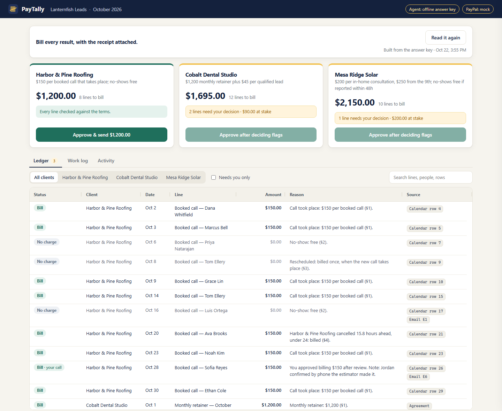

# PayTally

**An AI billing agent for pay-per-result work.** PayTally reads a month of messy work records (a calendar export, a CRM sheet, client emails), applies each client's terms, and drafts invoices where every line says why it is there and which row it came from. The owner approves with one click; only then does anything go to PayPal.

Built for the [PayPal AI Hackathon](https://paypalaihackathon.devpost.com/) (2026).



## Why

Agencies that bill per result (per booked call, per qualified lead, per appointment that actually happens) spend the end of every month reconciling: which calls took place, which were no-shows, which were reported in time, which lead was a duplicate, which line the client disputes. The data is spread across tools, and the terms differ by client. PayTally does that reconciliation and shows its work.

## How it works

1. **Claude reads the log.** `src/extract.js` sends every row, tagged with its reference (`calendar:12`, `crm:5`, `email:E3`), to Claude Opus 5.5 with a strict JSON schema. Claude reports what happened, item by item, with the rows it relied on. When the log can't settle something, it says why instead of guessing.
2. **Code checks the agent.** `src/ledger.js` confirms every row is accounted for, every cited row exists, and no row is billed twice. Anything that fails becomes a flagged line, never a charge.
3. **Code does the money.** `src/terms.js` prices each item under that client's terms (per held call; retainer plus per qualified lead; tiered per consultation with a 48-hour no-show window). Every line gets a plain-English reason naming the clause it applied.
4. **The owner decides.** The AG Grid review screen shows each line with its reason and sources. Flagged lines (a dispute, a missing outcome, an unclear lead) need a click: bill or credit, with a note. Prices re-compute, including tiers.
5. **One click sends.** Approve is the only route to PayPal. The approval is tied to a hash of the exact invoice the owner saw; if a line or a cent changes, PayPal refuses it (`src/approvals.js`, `src/paypal/index.js`).

## Run it

Requires Node 20 or later.

```bash
npm install
npm start
```

Open http://localhost:3000 and click **Read the work log**.

- With `ANTHROPIC_API_KEY` set, Claude reads the log (about a minute). Without it, the ledger is built from `data/answer-key.json`, a hand-checked reading of the same log, and the screen says so.
- PayPal is mocked until `PAYPAL_MODE=sandbox` and sandbox keys are set. The mock keeps invoices locally and sends nothing.

```bash
npm test        # terms engine, agent checks, approval guard, Claude request shape
npm run eval    # scores Claude's reading against the answer key (needs an API key)
```

## Demo data

Everything in `data/` is invented: the agency (Lanternfish Leads), its three clients, every person, and every amount. Emails use the reserved `example.com` domains.

## Status

Week 1 of 3: the ledger, terms engine, review screen and approval guard run locally on the demo data. Next: PayPal sandbox invoicing through the Agent Toolkit (create, send, reminders, paid webhook), dispute replies that cite the source row, and hosting on Render.

## License

MIT. See [LICENSE](LICENSE).
