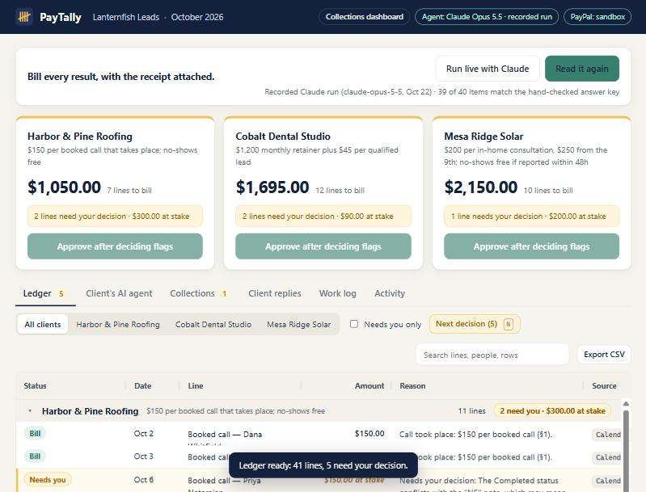
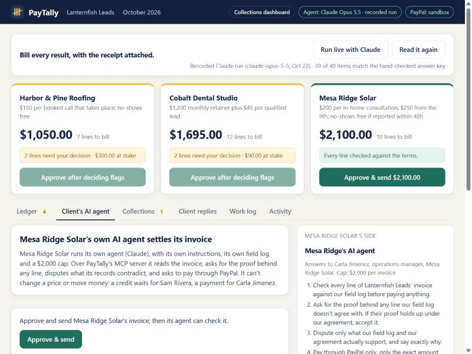

# PayTally

**An AI billing agent for pay-per-result work, and an MCP server the client's own AI agent can settle with.** PayTally reads a month of messy work records (a calendar export, a CRM sheet, client emails), applies each client's terms, and drafts invoices where every line says why it is there and which row it came from. The owner approves with one click; only then does anything go to PayPal. Then the client's AI agent checks the bill, disputes what its records don't support, and pays through PayPal once its human approves.

**Live demo:** https://paytally-wyzc.onrender.com (no sign-in; the free host can take a minute to wake). Collections dashboard: https://paytally-wyzc.onrender.com/studio.html

Built for the [PayPal AI Hackathon](https://paypalaihackathon.devpost.com/) (2026).





## Why

Agencies that bill per result (per booked call, per qualified lead, per appointment that actually happens) spend the end of every month reconciling: which calls took place, which were no-shows, which were reported in time, which lead was a duplicate, which line the client disputes. The data is spread across tools, and the terms differ by client. PayTally does that reconciliation and shows its work.

## How it works

1. **Claude reads the log.** `src/extract.js` sends every row, tagged with its reference (`calendar:12`, `crm:5`, `email:E3`), to Claude Opus 5.5 with a strict JSON schema. Claude reports what happened, item by item, with the rows it relied on. When the log can't settle something, it says why instead of guessing.
2. **Code checks the agent.** `src/ledger.js` confirms every row is accounted for, every cited row exists, and no row is billed twice. Anything that fails becomes a flagged line, never a charge.
3. **Code does the money.** `src/terms.js` prices each item under that client's terms (per held call; retainer plus per qualified lead; tiered per consultation with a 48-hour no-show window). Every line gets a plain-English reason naming the clause it applied.
4. **The owner decides.** The AG Grid review screen shows each line with its reason and sources. Flagged lines (a dispute, a missing outcome, an unclear lead) need a click: bill or credit, with a note. Prices re-compute, including tiers.
5. **One click sends.** Approve is the only route to PayPal. The approval is tied to a hash of the exact invoice the owner saw; if a line or a cent changes, PayPal refuses it (`src/approvals.js`, `src/paypal/index.js`).
6. **PayPal does the invoicing.** `src/paypal/sandbox.js` calls the official [PayPal Agent Toolkit](https://github.com/paypal/agent-toolkit) invoicing tools: `create_invoice`, `send_invoice`, `send_invoice_reminder`, `list_invoices`, `get_invoice`, `cancel_sent_invoice` and `record_refund_for_invoice`. Each line on the PayPal invoice keeps its reason and source rows.
7. **PayPal's webhook marks it paid.** `/api/paypal/webhook` takes `INVOICING.INVOICE.PAID`, `CANCELLED` and `REFUNDED`, checks PayPal's signature with `verify-webhook-signature`, and applies each event once (`src/paypal/webhooks.js`, `src/collect.js`). Nothing in PayTally marks an invoice paid on its own.
8. **Overdue invoices get a reminder.** The **Collections** tab lists every invoice with its PayPal status and the due date from the client's terms (15 days). An overdue one gets a reminder the owner reads first; the approval is tied to that exact text.
9. **Claude answers disputes, the owner decides.** When a client questions a line (**Client replies** tab), Claude finds the line, checks the rows it came from against the terms, cites them, recommends credit or keep, and drafts both replies (`src/replies.js`). Code checks every cited row exists. If the owner credits the line, the terms engine re-prices it and PayPal gets the change through the owner's click: a refund if the invoice is paid, or a cancelled invoice and a corrected one if it isn't.
10. **The client's own AI agent settles over MCP.** `/mcp` is a Model Context Protocol server (Streamable HTTP). A client's agent connects with a token scoped to that one client and gets six tools: `get_ledger`, `explain_charge`, `dispute_line`, `get_dispute`, `approve_and_pay`, `get_payment` (`src/mcp.js`). It can read, ask for proof, dispute and ask to pay. It cannot change a price, apply a credit or move money: a credit waits for the agency owner's click, and a payment waits for the client's human, who approves the exact amount. Its human's spending cap is enforced in code, not in the prompt.
11. **PayTally's agent rules on each agent dispute.** Claude reads the dispute against the work log and the terms, cites rows, and recommends credit or keep; the owner decides (`src/replies.js`).
12. **Real money moves in the PayPal sandbox.** The client's card is saved in PayPal Vault; an approved payment is a merchant-initiated Orders v2 charge on that saved card, and a credit on a paid invoice is a real Payments v2 refund of that capture, recorded on the PayPal invoice (`src/paypal/payments.js`). PayPal's webhook closes the invoice.

### Connect your own agent

Any MCP client can play the client's agent. With Claude Code:

```bash
claude mcp add --transport http paytally https://paytally-wyzc.onrender.com/mcp --header "Authorization: Bearer demo-mesa-ridge"
```

`demo-mesa-ridge` is a public demo token for the invented client Mesa Ridge Solar. Each browser gets its own demo, so the **Client's AI agent** tab shows a connect line whose token ends with your demo's id; copy that one and your agent works on your demo, and the tab shows every call it makes. The bare `demo-mesa-ridge` reaches the demo opened most recently.

### Collections dashboard (AG Studio)

`/studio.html` lays the month out in [AG Studio](https://www.ag-grid.com/studio/): billed, waiting on a decision, still owed and money PayPal moved; a custom "Who owes what" widget; billed and at stake by client; and the line and invoice grids. Studio's AI assistant runs on Claude: `public/studio/claude-adapter.js` turns Studio's turns into Claude Messages API calls through PayTally's server (`/api/studio/claude`, which streams Claude's events back), so the key stays on the server.

## Notes for judges

- **The demo always works.** **Read the work log** shows a recorded run: a real Claude Opus 5.5 reading of the demo log, saved in `data/recorded-run.json` and checked against a hand-checked answer key (39 of 40 items match; on the 40th, Claude flagged a row whose status says "Completed" while its note says "NS" and asked instead of guessing). No live API credit is needed to see it working.
- **Run live with Claude** appears when the server has an Anthropic key. It makes a fresh call (about a minute), scores the new reading against the same answer key, and shows the result. If the call fails for any reason (no credit, rate limit, network), the screen says why and falls back to the recorded run.
- **Try the human checkpoint:** open a flagged line (amber), read its sources, choose bill or don't bill, then approve that client's invoice. The **Work log** tab shows every raw row and the ledger line it became, or why it was left out. **Reset demo** at the bottom starts over. Each browser has its own demo (a cookie names it), so judges never see or reset each other's work.
- **Then follow the money.** On a sent invoice, **Client pays (test)** records a test payment in the PayPal sandbox; the card turns paid when PayPal's webhook arrives. **Client replies** brings in a dispute: Harbor & Pine's comes after paying (a credit becomes a refund), Cobalt Dental's before (a credit becomes a corrected invoice). **Collections** has last month's invoice, already overdue, ready for a reminder.
- **Dispute drafts work the same way as the reading:** recorded real Claude drafts by default (both match the hand-checked answer), with **Draft live with Claude** when the server has a key, falling back to the recording if the call fails.
- **Watch two agents settle a bill.** Approve Mesa Ridge's invoice, then open **Client's AI agent** and start its check. Its agent (Claude, replaying a recorded run; every tool call is real) checks 10 lines against its own field log, asks for proof on one and disputes it. Answer in **Client replies**, then let the agent finish: it checks the corrected invoice and asks to pay, and you approve as its human.
- **Everything PayPal-side is the sandbox,** with invented buyer accounts and PayPal's published test cards. No real money moves.

## Results

| Check | Result | How |
|---|---|---|
| Reading the work log | 39 of 40 items match the hand-checked answer key; the 40th flagged for the owner, not guessed | `npm run eval`, Oct 22, 2026 |
| Dispute drafts | 2 of 2 right line and right call | `npm run eval:replies`, Oct 22, 2026 |
| Two-agent settlement | 7 of 7 checks on the saved run | `npm run eval:settlement`, Oct 2026 |
| Real PayPal sandbox, end to end | passed: send, pay, refund, corrected invoice, agent settlement paid by saved card | `npm run smoke:sandbox` |

What failed on the way, and what changed: an early settlement run kept a charge the client's text showed was a no-show, because the text wasn't in the log; PayTally's agent now treats a call or text as outside the log and tells the owner what to check. Two later runs disputed a late-reported no-show the terms allow; the check now requires only that it is accepted, which matches the terms. PayPal's sandbox now refuses one of its own published test cards (PAYER_CANNOT_PAY), so the demo uses another.

## Run it

Requires Node 20 or later.

```bash
npm install
npm start
```

Open http://localhost:3000 and click **Read the work log**.

- With `ANTHROPIC_API_KEY` set, **Run live with Claude** is available. Without it, the recorded run is shown (or, if the demo data changed since it was recorded, `data/answer-key.json`), and the screen says which.
- PayPal is mocked until `PAYPAL_MODE=sandbox` and sandbox keys (`PAYPAL_CLIENT_ID`, `PAYPAL_CLIENT_SECRET`) are set. The mock keeps invoices locally, sends nothing, and fires its own "webhook" a moment after each payment or refund.
- On a public host, the app registers its own sandbox webhook at startup for `RENDER_EXTERNAL_URL` (set by Render) or `PUBLIC_URL`. Set `PAYPAL_WEBHOOK_ID` to use an existing one. Without a public URL, **Check PayPal now** reads the status directly.

```bash
npm test                          # terms engine, agent checks, fallback, approval guard, webhook handling, full mock flow
npm run eval                      # scores a live Claude reading against the answer key (needs an API key)
npm run eval -- --save            # same, and saves it as the recorded run
npm run eval:replies [-- --save]  # scores Claude's dispute drafts against the hand-checked answers
npm run eval:settlement [-- --save] # runs the two-agent settlement live and checks 7 things (needs an API key)
npm run smoke:sandbox [base URL]  # runs the whole flow against the real PayPal sandbox (local, or a deployed copy)
```

## Deploy (Render)

`render.yaml` is a Blueprint for one web service: build command `npm install`, start command `npm start`. Environment: `PAYPAL_MODE=sandbox`, `PAYPAL_CLIENT_ID`, `PAYPAL_CLIENT_SECRET`, and optionally `ANTHROPIC_API_KEY`. Optional limits for a public demo: `PAYTALLY_LIVE_SETTLEMENTS` (live agent runs per server, default 6), `PAYTALLY_LIVE_RULINGS` (live dispute rulings, default 12), `PAYTALLY_STUDIO_TURNS` (dashboard assistant turns, default 80). `AG_STUDIO` takes an AG Studio license key; without one Studio shows its trial watermark. Render's free tier keeps no disk between restarts, so each restart is a fresh demo. Each browser's demo lives in `var/demos/<id>/`; scripts and tests without the cookie share `var/state.json`.

## Demo data

Everything in `data/` is invented: the agency (Lanternfish Leads), its three clients, every person, and every amount. Emails use the reserved `example.com` domains.

## Status

Built and hosted: invoicing through the PayPal Agent Toolkit, paid by webhook, overdue reminders, Claude dispute replies that cite the source row, the client's agent settling over MCP, saved-card payments and real refunds in the PayPal sandbox, and the AG Studio dashboard. Next: the video and the write-up.

## License

MIT. See [LICENSE](LICENSE).
